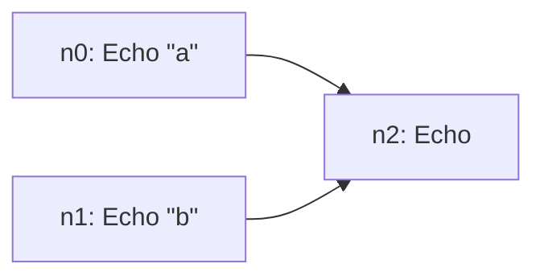

**draft** is a small s-expression language that compiles to [shuttle](https://github.com/heedle-ai/shuttle/wiki) plans. It's the readable front end for heedle-ai: you write the shape of the work, and shuttle runs it durably on Temporal.

```lisp
(pipe
  (par (echo "a") (echo "b"))   ; two branches, run concurrently
  echo)                         ; waits for both, receives "a b"
```



As plan data:

```text
n0 Echo [a] []
n1 Echo [b] []
n2 Echo [] [n0 n1]
```

`pipe` is sequential composition (`;`) and `par` is the parallel product (`⊗`). The diagram is generated from the compiled plan, and a test keeps it in sync.

[[/images/compile.svg|alt=The compiler as a composite: Parse ; Resolve ; Lower ; Finalize ; Validate]]
 Compiling catches unknown commands, wrong arguments and malformed graphs before anything runs.

## Where draft fits

| Repo | Role |
|---|---|
| [weft](https://github.com/heedle-ai/weft/wiki) | Composition algebra: what a step *is* |
| **draft** | Language: how you *write* a computation (this repo) |
| [shuttle](https://github.com/heedle-ai/shuttle/wiki) | Durable execution: how the work *ran* |
| [bobbin](https://github.com/heedle-ai/bobbin/wiki) | A fresh Podman container per agent step |
| [reed](https://github.com/heedle-ai/reed/wiki) | A fresh browser per browsing step, reaching only the hosts its program names |
| [warp](https://github.com/heedle-ai/warp/wiki) | Content-addressed store: what the system *knows* |
| [drawdown](https://github.com/heedle-ai/drawdown/wiki) | Web UI: write, run and browse programs and records |
| [loom](https://github.com/heedle-ai/loom/wiki) | Runs them together: compile, execute, record |

## Pages

- [Getting Started](Getting-Started): install, compile and run a program
- [Language](Language): the full syntax, and what each form compiles to
- [Adding Commands](Adding-Commands): turn a weft arrow into a command
- [Invariants](Invariants): every guarantee, the test that guards it, and the mistake it came from
- [Contributing](Contributing)

## Requirements

- Go **1.24** or later
- The Temporal CLI, only for running plans against a real server
- Linux (amd64 or arm64), or macOS on Apple Silicon
