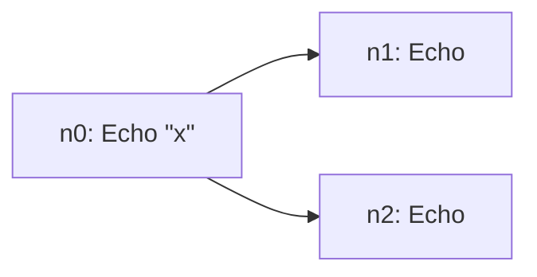
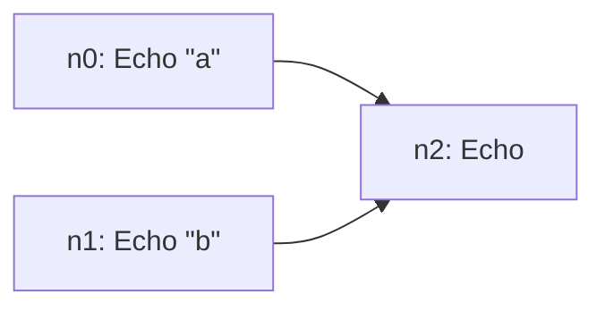
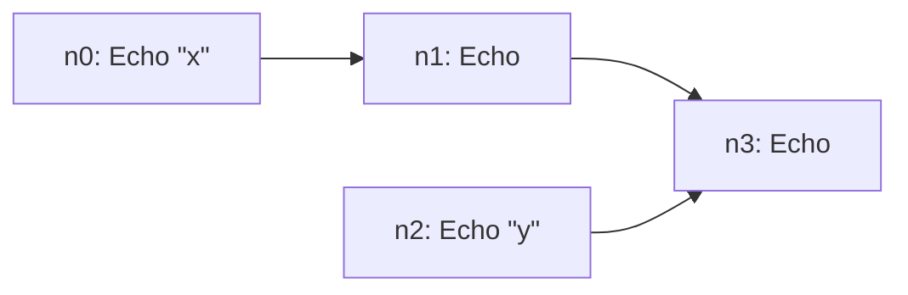
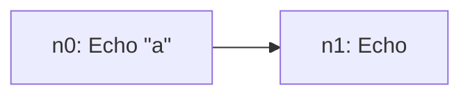

## Forms

| Form | Meaning | Compiles to |
|---|---|---|
| `(cmd "arg" 2)` | Run one command with literal arguments | One node; `Args` holds the arguments as strings |
| `cmd` | A command with no arguments | One node with no `Args` |
| `(pipe a b c)` | Run in sequence; each stage receives the previous stage's output | Each stage's first nodes `Require` the previous stage's last nodes |
| `(par a b c)` | Run concurrently on the same input | Branches side by side, with no edges between them |

Forms nest freely. A program is one top-level form.

## How pipe and par combine

Each diagram below is generated from the program above it and checked by `TestInv_WikiDiagramsMatchPlans`, so it always shows what the program really compiles to.

```lisp
(pipe (echo "x") (par echo echo))
```



Both branches of the `par` require `n0`, so both receive `"x"`. The plan has two leaves, `n1` and `n2`.

```lisp
(pipe (par (echo "a") (echo "b")) echo)
```



A stage after a `par` requires **every** branch's last node (fan-in), so it receives all their outputs, keyed by node ID. The built-in `echo` joins them in node-ID string order, so with ten or more nodes `n10` comes before `n2`.

```lisp
(pipe (par (pipe (echo "x") echo) (echo "y")) echo)
```



```text
n0 Echo [x] []        ; first branch, step 1
n1 Echo [] [n0]       ; first branch, step 2
n2 Echo [y] []        ; second branch
n3 Echo [] [n1 n2]    ; join: receives "x y"
```

These three shapes are tested in `run_test.go` and run through shuttle's real workflow.

Node IDs are `n0`, `n1`, … in source order. They're stable for a given program, which keeps plans deterministic and readable in Temporal's UI.

### A program's shape

A plan keeps only who waits for whom; the `pipe`s and `par`s are gone. `draft.Composition` gives them back, for drawing a program as it was written: a tree of `pipe`s (stages run one after another, `;`), `par`s (branches run side by side, `⊗`) and steps, each step named by its plan node's ID. A `pipe` or `par` of one part is just that part. drawdown draws run graphs from it.

```go
shape, _ := draft.Composition(context.Background(), draft.DefaultRegistry(), `(pipe (par (echo "a") (echo "b")) echo)`)
b, _ := json.Marshal(shape)
fmt.Println(string(b))
// {"kind":"pipe","parts":[{"kind":"par","parts":[{"kind":"step","node":"n0"},{"kind":"step","node":"n1"}]},{"kind":"step","node":"n2"}]}
```

`ExampleComposition` runs this, and `TestLaw_CompositionMatchesPlan` checks that a shape names exactly its plan's nodes, in order, and that what each step waits for, worked out from the shape alone, is what its plan node requires.

## Atoms

| Atom | Example | Notes |
|---|---|---|
| String | `"hello"` | Double-quoted |
| Number | `42`, `0.5` | Passed to the activity as a string (`"42"`). A command declares whether it accepts numbers |
| Symbol | `echo`, `pipe` | Command and form names |
| Keyword | `:backend` | Only used in `block` options |

Comments start with `;` or `//` and run to the end of the line. Strings may span lines and support the escapes `\n`, `\t`, `\r`, `\"` and `\\`. Whitespace is anything Unicode treats as a space.

Parsing is done by [participle](https://github.com/alecthomas/participle), a widely used Go parser library, from a five-rule lexer and a three-rule grammar in `sexpr/sexpr.go`. draft's own code only decides whether an atom is a keyword, a number or a symbol, and decodes strings with Go's `strconv.Unquote`. When participle replaced the earlier hand-written reader, a differential test ran both over 800,000 random inputs and found no difference in what they accepted or produced.

## Block options

An optional wrapper sets how the program runs. `script` is a synonym for `block`.

```lisp
(block :backend temporal :mode static
  (pipe (echo "a") echo))
```



| Option | Values | Default |
|---|---|---|
| `:backend` | `temporal` (or its synonym `sibyl`), `memory` | `temporal` |
| `:mode` | `static`, `dynamic` | `static` |

Only `temporal` + `static` compiles. `memory` and `dynamic` are still accepted by the parser, for compatibility with agentscript programs, but `Compile` rejects them: `finalize: only the temporal backend is supported (got memory)`.

A block takes exactly one body form. To run several things, wrap them in `pipe` or `par`.

## Current limits

- **One top-level form per program.** Two top-level forms fail with `lower: expected exactly 1 block, got 2`.
- **One built-in command, `echo`.** Everything else is added by you: see [Adding Commands](Adding-Commands).
- **Arguments are literals.** No variables or expressions yet.
